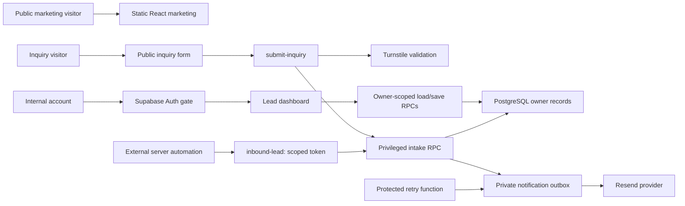
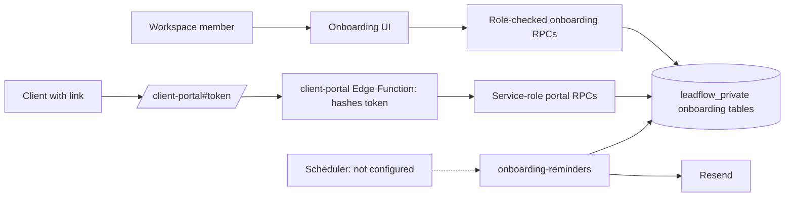

# LeadFlow architecture

Updated 19 October 2026. Current facts below were inspected in source and locally checked during M5. Proposed additions are explicitly separated and are not implemented. No architecture document previously existed in this checkout.

## Current stack and boundaries

React + TypeScript + Vite; Supabase Auth/PostgreSQL/Data API and Edge Functions; Cloudflare Turnstile; Resend. No Express server, message broker, generic workflow runner, or billing service. Vercel's existing rewrite serves the SPA on direct routes.

`src/Routes.tsx` selects lazy-loaded marketing, inquiry or protected dashboard. Public marketing routes are `/`, `/features`, `/integrations`, `/solutions`, `/pricing`, `/resources`, `/faq`, `/security`, `/signup`. `/inquiry` is separate. `/app`, `/app/*`, `/login` use `Dashboard` and `AuthGate`. Dashboard tabs are in-memory state; `/app/integrations` is not a real deep-linked tab. No new router or frontend stack is proposed.

The diagram describes logical flow, not a deployed scheduler guarantee. Public visitors never receive read access to lead records. Marketing illustrations use fictional data.

## Data and persistence

- Migration `202610180001_m2.sql`: public workspaces, leads, follow-up tasks, activity history, request receipts. `owner_id` is the Auth user's UUID, not an organization membership. Composite keys/foreign keys constrain related records to one owner. RLS allows own-row selects; writes use explicit-owner, empty-search-path security-definer RPCs.
- `load_workspace` returns the entire caller snapshot plus revision. `save_workspace` locks the workspace row, validates size/shape, rejects stale revisions, and replaces lead/task/history data atomically. A request ID + payload/revision fingerprint prevents retry duplicates. UI retains an unacknowledged attempt in memory for retry; refresh can lose the draft. No Realtime subscription.
- Migration `202610180002_m3.sql`: private inquiry receipts, email outbox and quotas. Intake inserts the lead/history/outbox in one transaction and advances dashboard revision. The request identity detects repeats; same ID with different content is rejected. Distinct legitimate inquiries can share an email address.
- Migration `202610180003_integrations.sql`: private integration keys contain SHA-256 hashes, owner and notification destinations. Safe metadata/receipt/revocation RPCs enforce Auth identity. Inbound tokens authorize lead creation only and are not third-party API credentials.
- Migration `202610200001_multi_tenant_foundation.sql` (20 October 2026):
  - Adds profiles, workspace memberships (owner/admin/member) and workspace settings.
  - Renames every `owner_id` above to `workspace_id`, keeping its value. Each former per-user workspace is that user's personal workspace.
  - RLS reads are membership-based. Every write function checks membership and role in the database. Intake takes the workspace from server configuration or the credential.
  - The dashboard still uses the personal workspace; there is no switcher or member UI yet.
  
  Details, role matrix and runbook: [docs/MULTI-TENANCY.md](docs/MULTI-TENANCY.md).

- Migration `202610250001_client_onboarding.sql` (25 October 2026, M6A, local only):
  - Adds onboarding templates, requests and checklist items, hashed client links, a reminder outbox, activity events and handoffs.
  - Every table is in `leadflow_private` with no client privileges. Members use 15 role-checked definer functions; the client portal and reminder worker use service-role functions through two new Edge Functions.
  - Requests reference leads by ID without a foreign key, so snapshot saves and resets never touch onboarding records.

  Details: [docs/CLIENT-ONBOARDING.md](docs/CLIENT-ONBOARDING.md).

## Client onboarding (M6A, implemented locally)

Readiness is computed in the database from item states, and the handoff is a single recorded event with no external effects. The design notes below were written before approval; M6A implemented the subset that was asked for, with a fixed state machine and no workflow engine.

## Current ingress and delivery

Public intake validates origin, normalized fields, payload size, request UUID, honeypot, Turnstile success/action/hostname and durable quotas. The destination is deployment-secret configuration, not a client-selected owner. Inbound automation rejects browser-Origin requests and validates its bearer credential; the database derives the owner from the credential. Origin rejection alone is not authentication.

Functions have gateway JWT checks disabled because they use different guards. The retry worker requires its server-only secret. Privileged Supabase and provider keys stay server-side; frontend receives only public configuration. Hosted Auth settings, origin lists and secret configuration are deployment responsibilities.

Notification sending happens after storage. The outbox uses row locking/leases, attempt state, bounded backoff and a provider idempotency key. `accepted` is not confirmed inbox delivery. Permanent errors remain visible; aged ambiguous sends become `uncertain` after the 23-hour retry window. A scheduler must invoke the worker; no cron installation is present. There are no delivery/bounce webhook handlers or general execution histories.

## Additive design under investigation (pre-M6A notes, kept for history)

M6A (above) has since been implemented locally at the owner's request. Differences from these notes:
- Snapshot compatibility was resolved by linking leads by ID with no foreign key.
- Requests start as drafts and are opened explicitly; there is no separate "commercial confirmation" step.
- Waived required items are "marked not required" with an agency-only reason.
- Reminder execution history lives in `onboarding_reminders`, separate from the inquiry outbox.

Original notes: only if M6 is approved, implement one fixed kickoff-readiness workflow on this stack. Use ordinary PostgreSQL state and narrow Edge Functions/RPCs. Do not add an automation DSL, user-defined code, generic trigger/action catalog, Redis, orchestration cluster, or another web server.

### Necessary product changes and reuse

| Surface | Reuse | Necessary new behavior if approved |
| --- | --- | --- |
| Positioning/marketing | Existing routes, tokens, header, cards, truthful planned labels | Narrow readiness copy after approval; publish capability claims only after verification. M5 changes no marketing code. |
| Leads/dashboard | Contact fields, account gate, table/filter patterns | Explicit Start kickoff action with recipient and commercial-confirmation review. Do not equate Converted with a signed/paid agreement. Separate queue for requests. |
| Follow-ups | Date helpers and familiar task UI | Existing tasks remain manual. Automated reminders use separate lifecycle/cancellation rules. |
| Configuration/activation | Current validation, confirmation and save-feedback patterns | One fixed template; required/optional items, due date and bounded reminder cadence; preview and explicit activation. Activation requires a verified sender and valid recipient. |
| Public forms | Input normalization and component conventions | Dedicated scoped request endpoint/UI. `/inquiry` remains lead creation; its owner secret and CAPTCHA are not client authorization for reading requests. |
| Integrations | Server runtime, safe metadata and receipt patterns | Initially link existing asset locations; no OAuth required. Later one justified PM adapter, only after plan/scopes and failure semantics are proven. |
| Business state | Supabase database and owner isolation | Separate kickoff request/items, submitted/reviewed state, owner decision and immutable transition records. Small, fixed state machine, not configurable workflow logic. |
| Execution history | Lessons from inquiry receipts/outbox | Separate operation/attempt records with request, action, payload version, status, next retry, safe error code and external reference. Existing activity remains a user-facing history. |
| Permissions | Existing signed-in owner boundary | Owner-only internal management; expiring/revocable client token scoped to one request and allowed operations. No workspace browsing or hidden owner fields from client input. |
| Credentials | Server secrets and hashed inbound tokens | Client access tokens hashed at rest. If later OAuth is required, recoverable encrypted tokens need server-only storage and revocation/refresh; hashing alone cannot serve outbound OAuth. No frontend tokens. |

### Business states and external effects

Proposed request states: draft, active, needs-review, ready, paused, cancelled. Items distinguish missing, submitted, accepted and changes-requested. Only the agency can accept an item or mark a required item waived with a reason. A submitted form is not readiness. A ready handoff is emitted once for a specific request version after all required items are accepted/waived. Reopening requires an explicit new version rather than silently sending another handoff.

An operation ledger separately tracks queued, leased/in-progress, provider-accepted, retryable-failure, terminal-failure and uncertain outcomes. Enqueue effects with the business transition in a transaction. Use a unique owner/request/version/action identity and immutable payload fingerprint. Retrying an unchanged event reuses the identity; changed payload under the same identity fails. Do not reuse the inquiry request-ID namespace/schema as a generic event bus.

Workers must recheck cancellation/current request version before sending. Retry bounded transient failures with jitter/backoff; missing credentials and invalid recipients require owner action. Unknown remote outcomes need reconciliation before resending where provider dedupe is insufficient. “Exactly once” across third-party networks must not be promised. No automatic retries beyond the provider's known dedupe window without reconciliation. Invitation/reminder delivery state must remain separate from client completion and business readiness.

### Snapshot compatibility — resolve before schema work

Current `save_workspace` deletes/reinserts leads. A normal `ON DELETE CASCADE` link from workflow records to leads could erase workflow history on every edit. Keep new state outside that snapshot and choose tested non-cascading linkage/deletion behavior. Copy only necessary contact context into the request at explicit activation; define what later contact edits mean. Decide what reset does with active requests before enabling the feature. Prefer preserving requests and warning about detached leads over silently deleting or resending. Never perform a production migration or reset to test this.

### Required UI states

- Loading: explicit fetching/saving/activating states; prevent double activation.
- Empty: explain how to create the first request, with no fake runs or success badges.
- Draft: preview exact items/recipient and state that no client message has been sent.
- Active: show missing items, due date, next permitted reminder and who acts next.
- Submitted/needs-review: distinguish data received from data accepted.
- Ready: reviewed completion plus one handoff reference; do not infer readiness from an email acceptance.
- Failed/uncertain: human-readable cause, safe details, pause/retry/reconcile controls; keep collected information.
- Expired/revoked link: generic safe error without client/workspace enumeration; owner can issue a replacement.
- Conflict/network loss: recover acknowledged state and preserve retry identity; no false saved message.

## Security and operations sequence

M6 must include essential authorization, scoped token lifetime/revocation, transactional integrity, duplicate safety, cancellation and delivery error handling **before any external participant**. M7 is additional hardening, not permission to defer these basics. Do not collect client passwords or automatically fetch arbitrary submitted URLs. Link-only assets avoid storage policies and file scanning in the first slice; they do not prove the agency can access or use the asset, so owner review remains necessary.

M7 should verify hosted two-owner/client access boundaries, scheduler recovery, provider limits and delivery/bounce evidence, secret rotation, backup restore, data retention/deletion, abuse controls, safe logs, alerts and runbooks. Shared teams require a separately approved membership design; never simulate roles by sharing credentials. Use controlled beta accounts and disposable test data, not destructive production migrations.

The [research](docs/M5-RESEARCH.md#technical-feasibility-sources) links official Google Drive/ClickUp API documentation as future feasibility evidence only. M5 implemented no connector, client portal, workflow schema or runner. M6A later added the client portal and a fixed onboarding schema; it still adds no connector or generic runner.
