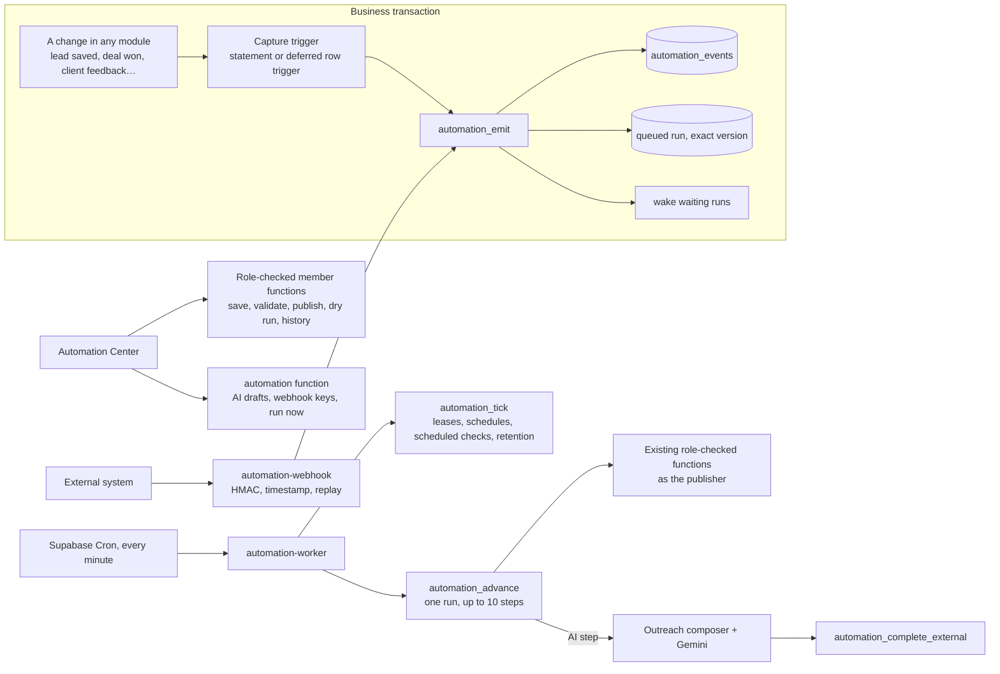

# Automation and workflow engine (M13)

**Status: implemented and verified locally, 27 November 2026.**

The same day, M13 went live on https://leadflowglobal.vercel.app: both migrations, the three Edge Functions, the every-minute Cron job and the frontend (commit `4440abc` on `main`). See [Hosted rollout](#13-hosted-rollout-27-november-2026).

The Automation Center (sidebar → Workspace → **Automations**) lets owners and admins build workflows:
- a trigger, then conditions, actions, delays, waits for events and branches;
- each workflow is published as an immutable version and run on the server by the automation worker;
- every run has a step-by-step history.

The core principle from the specification holds throughout: automate repetitive work, keep business decisions with people. No workflow can:
- send outreach;
- mark a deal won or lost;
- confirm scope or approve requirements;
- approve on a client's behalf, or invent client feedback.

Sections 1 and 2 are the audit and plan written before implementation. Sections 3 onwards describe what was built.

## 1. Pre-implementation audit

These findings come from the repository, not from the original milestone prompts.

| Area | What exists (inspected) | Consequence for M13 |
|---|---|---|
| Leads, follow-up tasks, lead history | `public.leads`, `public.follow_up_tasks`, `public.activity_history`, saved as a **whole-workspace snapshot** by `save_workspace_for`, which deletes and re-inserts every row. Intake (`receive_webhook`, `receive_*_inquiry`), `import_leads` and `apply_plan` insert rows directly and bump the workspace revision. | Row triggers cannot tell "created" from "re-saved". Lead and task events are detected by comparing each write with a per-entity state table, from statement-level triggers. This covers every insertion path without changing `save_workspace_for`. |
| Tasks | One task system: `follow_up_tasks`, extended by M9 (deal, type, priority, assignee), M10 (client, onboarding) and M11 (project, milestone, deliverable, work status). `check_follow_up_task` validates links. Server-side writers bump the revision (`bump_workspace_revision`). | The "create task" action inserts there and bumps the revision, as `apply_plan` does. No second task table. |
| Activity | Lead history (`activity_history`), deal timeline (`deal_activities`, `deal_stage_history`), client and project history (`client_activities`, written by `client_event`, `project_event` and `collab_event`). | Notes go to the existing history for their record. Most client, project and collaboration events are observed on their own tables. |
| Notifications and email | M12 `portal_notifications` (member and client, deduplicated per person) through `queue_notification`, plus per-member email preferences and `portal_email_outbox`, sent by the `portal-notifications` worker with leases, retries and idempotency keys. | The notify action uses `queue_notification` with a new `automation_alert` event that members can switch email on or off for. No new notification table or email sender. |
| Background jobs | Supabase Cron (`supabase/ops/schedule-workers.sql`) calls Edge workers with `x-worker-secret` (`NOTIFICATION_WORKER_SECRET`). Jobs use leases, `next_run_at`, attempts and `for update skip locked` (analyses, contact searches, outboxes). | A new `automation-worker` uses the same secret, the same Cron pattern and the same lease and next-run columns. Delays and waits are rows with a due time, never a sleeping process. |
| AI | `geminiClient` (no SDK), prompt-injection fencing (data in a delimited JSON block), strict output validation, usage ledger `outreach_usage`, monthly reservations, per-minute `inquiry_rate_limit`. | The AI workflow drafter and the "generate outreach draft" action reuse the client, the fencing pattern, the ledger and the outreach composer (`outreach_context`, `buildOutreachPrompt`, `validateDraft`, `save_generated_draft`). |
| Integrations | `inbound-lead`: bearer credentials stored as SHA-256 hashes, rotation and revocation, UUID request IDs, `inquiry_rate_limit`, bounded JSON parsing, no browser origins. No signatures or timestamps. | External systems keep creating leads through `inbound-lead`, and those leads fire `lead.created`. A signed workflow webhook (HMAC, timestamp, replay protection) extends the same patterns for starting a workflow with custom data. |
| Authorization | Security-definer functions with an empty search path. `require_role` reads `auth.uid()` (with anonymous sessions refused). Client portal accounts are refused by `current_profile`. Private tables are in `leadflow_private` with no client privileges. | Every M13 table is private. Members use role-checked functions, and the worker uses service-role functions. Actions run **as the member who published the workflow version**, through the existing role-checked functions, so permissions are checked again at execution time. |
| Time zones | `workspace_settings.timezone` (default UTC); `project_today` uses it. | Schedules and date conditions use the workspace time zone. |
| Frontend | React 19 + Vite, in-memory page state (`src/lib/pages.ts`), the `--lf-*` design tokens, `.panel` and `.section-heading` primitives, `Modal` (dialog or drawer), light and dark themes. No graph or canvas library is installed. | The builder is a structured vertical flow with branch columns, built with the existing primitives. No canvas dependency. |
| Tests | PGlite runs the real migrations (`tests/support/database.ts`). Edge handlers run in-process with simulated providers (`tests/support/*.ts`). Playwright runs against PGlite through `mockSupabase`. | `npm run test:automation` (database, engine and handlers) and `tests/automation.spec.ts` (browser), plus every existing suite as regression. |

Facts that limit the trigger list:
- Leads have no owner or assignee, so "lead assigned" and "lead updated (any field)" are not offered.
- Project health is computed, not stored, so "health changed" cannot be observed reliably.
- LeadFlow has no inbox, so "reply received" is the reply a person records on a deal (added as `deal.reply_recorded` on 28 November).
- Outreach drafts have no approval state. A person marking a draft *ready* is the closest event.

## 2. Implementation plan

**Existing infrastructure to reuse:**
- Snapshot tables and revision bumps.
- `queue_notification` and `portal_email_outbox`.
- Role-checked functions:
  - `create_deal`, `start_business_analysis`, `start_contact_discovery`, `start_client_onboarding`;
  - `create_project`, `project_setup_for`, `project_template_plan`;
  - `save_project_milestone`, `set_project_status`, `save_project_deliverable`, `request_deliverable_review`;
  - `add_client_note`, `add_project_note`, `record_deal_activity`.
- Supabase Cron and the worker secret.
- `inquiry_rate_limit`.
- The Gemini client and the AI usage ledger.
- The outreach composer.
- `EMAIL_HASH_SECRET` (already required by `inbound-lead`) to derive webhook signing keys.
- **No new environment variables, no new dependencies.**

**Supported event sources:** statement triggers on `leads` and `follow_up_tasks`, and deferred row triggers on:
- `business_analyses`, `lead_contacts`, `outreach_drafts`, `deal_stage_history`, `deal_meetings`;
- `clients`, `onboarding_requests`, `onboarding_items`, `client_scope_confirmations`, `client_onboarding_completions`;
- `projects`, `project_milestones`, `project_deliverables`;
- `deliverable_reviews`, `deliverable_decisions`, `deliverable_feedback`, `project_comments`, `client_documents`, `project_updates`;
- `client_invitations`, `client_users`.

Deferred triggers fire at commit, so they see related rows written later in the same transaction. Scheduled checks (overdue tasks, milestones and projects, deals closing soon, time schedules) are evaluated by the worker. Signed webhooks are received by `automation-webhook`.

**Workflow data model** (all in `leadflow_private`):
- `automation_workflows`: draft definition and status.
- `automation_versions`: immutable published definitions and who published them.
- `automation_events`: a transactional outbox, written only when something listens.
- `automation_runs`: executions with context, current node, leases, waits and errors.
- `automation_run_steps`: step history with sanitized input and output.
- `automation_webhooks`: endpoint metadata and secret version; no secret is stored.
- `automation_entity_state`: snapshot change detection.
- `automation_usage_daily`: usage counters.
- `automation_settings`: the workspace pause switch.

**Execution architecture:**
1. An event is matched in the same transaction as the business change. The trigger filter is evaluated, and a queued run that references the exact published version is inserted.
2. The worker claims runs fairly (bounded per workspace) and executes nodes. Each node runs in its own subtransaction, so a node's side effect and its step record commit together, or neither does.
3. Delays and waits persist `next_run_at` and a wait key, and incoming events wake matching waits.
4. AI steps leave the transaction: they are leased, executed by the Edge worker and finished idempotently.

**Security boundaries:**
- Owners and admins manage and publish. Members can view and dry-run.
- Consequential actions need an explicit confirmation in the node and an owner or admin publisher.
- Actions execute as the publisher and re-check the publisher's role. Losing access pauses the workflow with a reason.
- Field paths are checked against the registry, and there are no expressions.
- Loop protection uses the causal chain and a depth limit.
- Rate limits apply per workflow and per workspace.
- Logs are sanitized: no emails, phone numbers, tokens or free-text bodies beyond short previews.

**Background processing:** one new Cron job (every minute) calling `automation-worker`. It fires due schedules and scans, re-queues expired leases and timed-out waits, then advances runs for about 50 seconds.

**Testing strategy:**
- PGlite suite over the real migrations: registry, conditions, triggers from every module, actions, engine states, retries, waits, idempotency, loops, permissions, cross-workspace access, versioning.
- Handler tests for the worker, the webhook (signatures, timestamps, replays) and the AI drafter (with a simulated model).
- Playwright tests for the Automation Center and the builder.
- All existing suites as regression.

## 3. Architecture



The concerns the specification asks to separate live in separate places:

| Concern | Where |
|---|---|
| Event registration and publishing | `automation_capture`, `automation_capture_leads`, `automation_capture_tasks` (part 1 migration) → `automation_emit` |
| Workflow matching | `automation_emit`: indexed lookup `(workspace, trigger type)` of active workflows, trigger filter, loop and rate checks |
| Validation | `automation_check` and helpers: registry-only types, fields, operators, inputs, scoping, limits |
| Condition evaluation | `automation_eval_group` / `automation_eval_condition` |
| Action execution | `automation_execute` (database actions), `runExternal` in `_shared/automation/engine.ts` (AI) |
| Execution persistence | `automation_runs`, `automation_run_steps`, `automation_step`, `automation_finish` |
| Scheduling and waits | `automation_tick`, `automation_next_fire`, `next_run_at` and `wait` on runs |
| Retry and recovery | `automation_classify`, `automation_backoff`, lease release in the tick, `automation_retry_run`, `automation_rerun` |
| Monitoring and usage | `automation_usage_daily`, `automation_overview_for`, `automation_runs_for`, `automation_run_detail` |

The frontend never runs a workflow. It edits drafts, previews dry runs (computed in the database without writes), and shows history. **Run now** buttons ask the `automation` Edge Function to advance one run on the server.

## 4. Registry

Everything a workflow can use is declared in the database (`automation_catalog()`). The builder and the AI drafter read the same registry, and validation checks against it. There are no expressions and no code.

### Triggers (46)

Each trigger has:
- a stable ID (`group.event`);
- its fields (payload schema) and its subject record;
- match keys for waits;
- for scheduled checks, its settings.

Every payload includes the workspace context (`workspace.name`, `run.date`), the originating record, and the event time (`event`, `run.startedAt`).

| Group | Triggers | Observed from |
|---|---|---|
| Leads | `lead.created`, `lead.status_changed`, `analysis.completed`, `analysis.failed`, `task.created`, `task.completed`, `task.overdue` (scheduled check) | leads and tasks: statement triggers comparing each write with the last state seen; reports: `business_analyses` status |
| Contacts & outreach | `contact.created`, `outreach.draft_created`, `outreach.marked_ready`, `outreach.marked_sent` | `lead_contacts`, `outreach_drafts` |
| Sales | `deal.created`, `deal.stage_changed`, `deal.won`, `deal.lost`, `deal.meeting_scheduled`, `deal.proposal_sent`, `deal.reply_recorded` (with sentiment and channel), `deal.close_approaching` (scheduled check) | `deal_stage_history`, `deal_meetings`, `deal_activities` (proposals and replies people record) |
| Clients & onboarding | `client.created`, `client.invited`, `client.activated`, `onboarding.started`, `onboarding.item_submitted`, `scope.confirmed`, `onboarding.completed` | `clients`, `client_invitations`, `client_users`, `onboarding_requests`, `onboarding_items`, `client_scope_confirmations`, `client_onboarding_completions` |
| Projects | `project.created`, `project.status_changed`, `project.overdue` (scheduled), `milestone.created`, `milestone.completed`, `milestone.due_soon` (scheduled), `milestone.overdue` (scheduled), `deliverable.created`, `deliverable.status_changed` | `projects`, `project_milestones`, `project_deliverables` |
| Client collaboration | `deliverable.shared`, `review.requested` (resubmissions flagged), `feedback.submitted`, `deliverable.changes_requested`, `deliverable.approved`, `deliverable.rejected`, `comment.client_created`, `file.client_uploaded`, `update.published` | `project_deliverables`, `deliverable_reviews`, `deliverable_decisions`, `deliverable_feedback`, `project_comments`, `client_documents`, `project_updates` |
| Schedules & webhooks | `schedule.time` (daily, weekly, monthly or once, in the workspace time zone), `webhook.received` | the worker; `automation-webhook` |

Row events use **deferred** constraint triggers. They fire at commit, so they see rows written later in the same transaction (opportunities saved with a report, feedback items saved with a decision), and they read each record as it finally is. A capture that fails logs a warning and never breaks the business change.

Payloads hold only what workflows need. They never carry email addresses, phone numbers, messages, internal notes or credentials; `hasEmail` and `hasPhone` flags are given instead. Each event has a dedupe key, so a repeated delivery (a re-saved snapshot, a retried request) never makes a second event.

**Not offered, because they can't be observed reliably:**
- lead assigned: leads have no owner;
- lead updated (any field);
- project health changed: health is computed, never stored;
- contact verification completed.

### Actions (16)

Each action declares:
- an ID, label and description;
- its inputs (subject, template, enum, number, assignee, recipients, due date, stage, template choice, confirmation);
- its outputs and the roles it needs;
- a retry budget and a side-effect class.

| Action | Side | Reuses |
|---|---|---|
| `task.create` (lead, deal, client, project, milestone or deliverable) | internal | `follow_up_tasks` + `bump_workspace_revision` (as `apply_plan` does) |
| `note.add` (lead, deal, client, project) | internal | lead history; `record_deal_activity`; `add_client_note`; `add_project_note` |
| `notify.members` (optional email) | internal | `queue_notification` + `portal_email_outbox`, per-member preference `automation_alert` |
| `lead.set_status` (New, Contacted, Qualified only) | internal | the lead row + lead history + revision |
| `analysis.start` | internal | `start_business_analysis` (the analysis worker continues it) |
| `contacts.discover` | internal | `start_contact_discovery` |
| `outreach.generate_draft` (AI) | internal | `outreach_context`, `recommendOutreach`, `buildOutreachPrompt`, `validateDraft`, `save_generated_draft` |
| `deal.create` | internal | `create_deal` (its duplicate check) |
| `deal.add_activity` | internal | `record_deal_activity` |
| `deal.move_stage` (open stages only) | **consequential** | `move_deal` |
| `onboarding.start` (skips if the client has one) | internal | `start_client_onboarding` |
| `project.create_from_onboarding` (once per handoff) | internal | `project_setup_for`, `project_template_plan`, `create_project` |
| `milestone.create` | internal | `save_project_milestone` |
| `deliverable.set_status` | internal | `save_project_deliverable` |
| `project.set_status` (not started, in progress, on hold) | **consequential** | `set_project_status` |
| `review.request` (latest version; the client is notified) | **consequential**, client-visible | `request_deliverable_review` |

Consequential actions:
- need an explicit confirmation in the step;
- need an owner or admin publisher;
- are flagged in the builder, dry runs, the publish dialog and AI drafts.

**Deliberately not available:**
- sending outreach or emails to leads or clients;
- marking deals won or lost;
- confirming scope or approving requirements;
- approving deliverables;
- converting a deal to a client (M10's reviewed conversion stays human: the "Deal won" template creates a conversion task instead);
- inviting client people;
- publishing client updates;
- completing or cancelling projects;
- generating onboarding summaries.

## 5. Conditions, variables and branching

**Operators:**
- text: equals, does not equal, contains, does not contain, starts with, is empty, is not empty;
- enum: the same, plus any of and none of;
- number: equals, more than, less than, at least, at most, between;
- dates: before, after, on, within the next N days, overdue (date has passed);
- booleans: is true, is false;
- lists: contains item, does not contain item, empty, not empty;
- references (record IDs): empty or not empty only.

**Groups:**
- `all` or `any`;
- nested up to 3 levels;
- at most 10 conditions per group and 60 per workflow.

**Missing and null values count as empty.** `is empty` is true. Positive comparisons are false, and their negations (`does not equal`, `does not contain`, `none of`) are true. An undecided comparison never counts as a match. Text compares without case.

**Paths:**
- Only registered paths are accepted.
- At run time, only the `trigger`, `steps`, `workspace` and `run` roots of the run's own context can be read, segment by segment.
- Anything else is empty.
- Nothing is evaluated as code.

**Variables:**
- Text inputs use `{{path}}`.
- They are filled from the same registered paths, and unknown variables become empty text.
- The builder's **Insert variable** picker lists exactly the fields available at that step: the trigger's fields, then outputs of earlier steps on the same path (for example `{{steps.n1.taskId}}`, `{{steps.n3.opportunityCount}}`).
- A branch's outputs stay inside that branch. Validation refuses a later step that uses them.

**Branches:**
- 1 to 5 named paths plus Otherwise; the first matching path is taken.
- Every path continues with the steps after the branch.
- A workflow is a tree, compiled at publish time into nodes with explicit `next` pointers. A cycle or an unreachable step can't be expressed.

## 6. Execution engine

### Lifecycle

`queued` → `running` → `completed`, with these other ends:
- `waiting`: a delay or an event wait;
- `failed`;
- `cancelled`;
- `attention` ("Requires attention"): a configuration or permission problem a person must fix.

Outcomes say why a run ended: `condition_not_met`, `wait_timed_out`, `loop_blocked`, `retries_exhausted`, and others.

1. **Match** (in the business transaction):
   - The event is inserted only if an active workflow or a waiting run listens.
   - The trigger filter is evaluated.
   - Loop and rate checks run.
   - A queued run is created that references the exact published version, with a sanitized context.
2. **Claim:** `automation_advance` serves workspaces in turn (`served_at`). It skips workspaces with 3 runs already running, and picks the oldest due run with `for update skip locked`.
3. **Execute:**
   - Up to 10 steps per call.
   - Each action runs in its own subtransaction, so its side effects and its step record commit together, or neither does.
   - Delays and waits persist `next_run_at` and the wait key, then end the call.
   - AI steps lease the run (5 minutes) and return the job to the Edge worker. `automation_complete_external` saves the draft with the step's request ID and continues the run.
4. **Finish:** `automation_finish` records the status, outcome, sanitized error and failed step, plus daily usage counters.

Maximum run age is 30 days including waits, and at most 100 steps execute per run. An unexpected engine error rolls back that call and marks the run as needing attention, so it can't loop.

### Permissions at execution time

- Each action runs **as the member who published the version** (`request.jwt.claims` set transaction-locally).
- It goes through the existing role-checked function, which checks that member's membership and role again.
- If the publisher has left or lost the role, the action fails with `authorization`, the run needs attention, and the workflow is **paused with a reason**.
- A workflow can therefore never do more than the person who published it. Consequential actions also need an owner or admin publisher, both at publish time and at run time.

### Retries

| Class | Examples | Behaviour |
|---|---|---|
| transient | version conflicts (40001), deadlocks, lock timeouts, statement timeouts, limits that reset (P0429), AI timeouts and outages | retried after 1, 5, then 25 minutes, up to the action's budget (3, or 2 for AI); then `failed` with `retries_exhausted` |
| invalid | a record that can't do it (no website, deleted lead), bad configuration | `failed` (record problems) or `attention` (configuration), no automatic retry |
| authorization | the publisher's access | `attention`, workflow paused |

People can:
- **Retry from the failed step** (owners and admins): same version, completed steps not repeated.
- **Run again from the start**: a new run of the current version; explicit confirmation, because completed steps may create duplicates.
- **Cancel** a run.
- Pause, edit and republish the workflow.

### Idempotency

| Situation | Protection |
|---|---|
| The same event delivered twice | `automation_events` unique `(workspace, dedupe_key)`; one live run per `(workflow, event)` |
| A worker retries a database step | the step's side effects and its step record share a subtransaction; a rolled-back attempt left nothing behind |
| A timeout after commit, or a resumed run | every side effect uses `automation_key(run, step)` as its request ID or record ID (`create_deal`, `start_business_analysis`, `add_client_note`, `request_deliverable_review`, `create_project`, task IDs `auto-<key>`, notification dedupe keys) |
| An AI step whose worker died | the lease expires and the step runs again; `outreach_context` returns the draft already saved for that request ID |
| A manual retry | resumes at the failed step with the same keys |
| Scheduled checks | one event per record and window (task and due date; milestone, due date and window; project and target date; deal and close date) |

### Delays and waits

- **Delays:** minutes, hours or days (up to 90 days), or until a date and time.
- **Waits for an event:** a report completed, a task completed, a deal stage changed or won, a reply recorded on the deal, a client submitting information, onboarding completed, a deliverable approved or changes requested, client feedback.
  - Each wait matches the record the run names, for example `task:<id>`.
  - It has a timeout (1 hour to 30 days) that either continues (the step reports `received: false`) or stops.
  - A matching event wakes the run immediately.
  - Everything is stored in the run, so restarts lose nothing.

### Loops and limits

- An event caused by a workflow's own action never starts that workflow again.
- Chains of workflows triggering each other stop after 3.
- Blocked runs are recorded with the reason.

| Limit | Value |
|---|---|
| workflows per workspace | 100 |
| steps per workflow | 40 |
| branch depth / condition depth | 3 / 3 |
| runs per workflow per hour | 100 (then skipped, counted as throttled; the workflow stays active and is flagged) |
| runs per workspace per hour | 1,000 |
| concurrent runs per workspace | 3 |
| live tests per workspace per hour | 30 |
| event retention / run retention | 30 / 180 days |

The workspace **pause** switch (Settings) stops new runs and holds queued ones.

## 7. Builder, testing, versions and templates

**Builder:**
- A vertical flow canvas with branch columns, and an add-step menu between steps (action, condition, branch, delay, wait).
- A settings panel per step, with title, description, help, fields, validation messages, available data and the step's outputs.
- Steps can be moved up or down, duplicated and deleted.
- Paths stack on phones.
- The server validates every edit (debounced), and issues are shown on the steps.
- **Save draft** never changes the live version. Leaving with unsaved changes asks first, and the browser warns on reload.

**Testing:**
- **Dry run:** evaluates the filter, conditions and branches against representative data. The data comes from a recent record of the workspace (editable), or example values when there is none. It shows rendered inputs and side effects, and **writes nothing**; the test suite checks the row counts of every affected table.
- **Live test:** owners and admins, valid saved draft, explicit confirmation. It runs once with the tester's authority, is labelled "Live test" and is kept out of production metrics.

**Versions:**
- Publishing checks everything, stores an immutable version with its compiled form and publisher, and activates it.
- Runs keep the version they started with.
- History lists every version; **Restore to draft** copies one back, and publishing it is a separate step.

**Templates (12, all registry-only, all created as editable drafts):**
- Lead qualification;
- Qualified lead follow-up;
- High-opportunity lead (AI draft and review task);
- Deal won → client onboarding (a conversion task, so M10's reviewed conversion isn't bypassed);
- New client → start onboarding (skips when the conversion already started it);
- Onboarding completed → project setup (once per handoff);
- Project deadline reminder (once per milestone and due date);
- Deliverable review (consequential, arrives unconfirmed, needs the project shared on the portal);
- Client revision request;
- Deliverable approved (notifies and completes the deliverable internally; never the project);
- Project overdue;
- Client feedback triage (branches by category).

**AI-assisted creation:**
- Owners and admins describe a workflow.
- The `automation` function sends the registry as the vocabulary, and the description as an escaped JSON string inside `<request>` that the model is told to treat as data.
- The answer is filtered to registered step types, actions, inputs and waits. IDs are renumbered and consequential confirmations are turned off. The database validates it.
- The person sees the summary, side effects, unsupported wishes and issues. **Nothing is saved or published**; "Review in builder" opens it as an unsaved draft.
- Usage is recorded in the existing AI ledger (`automation_build`), with a monthly allowance equal to `PROJECT_AI_MONTHLY_LIMIT` and 60 requests a minute.

## 8. Webhooks

Each workflow with the **Signed webhook received** trigger can have one endpoint (`automation_webhooks`).

**Keys:**
- The signing key is `whsec_` + HMAC-SHA256(`EMAIL_HASH_SECRET`, `automation-webhook:<id>:<version>`).
- It is shown once when created or rotated. **The database stores no secret**, only the version.
- Rotating increases the version, and the old key stops working at once. Revoking stops the endpoint.
- Changing `EMAIL_HASH_SECRET` changes every webhook key (and the inbound-lead email hashes); rotate the keys afterwards.

**Request:**

```
POST https://<project>.supabase.co/functions/v1/automation-webhook
Content-Type: application/json
X-LeadFlow-Webhook: <endpoint id>
X-LeadFlow-Timestamp: <Unix seconds>
X-LeadFlow-Signature: v1=<hex HMAC-SHA256 of "<timestamp>.<raw body>" with the signing key>

{"eventId":"<unique per event>","data":{"company":"Acme","score":87}}
```

**Checks:**
- Browser origins are refused.
- The timestamp must be within 5 minutes; the signature is compared in constant time.
- Unknown and revoked endpoints look the same as bad signatures. Rejected attempts are counted.
- 60 requests a minute per endpoint (the M3 limiter).
- At most 16 KB.
- `eventId` replays are duplicates (202 `duplicate: true`), not new runs.
- Only fields the workflow declares are kept, each checked against its type (text, number, true/false, date) and whether it is required.

**Responses:**
- 202 received;
- 401 signature, timestamp or endpoint;
- 409 workflow not active;
- 413 too large;
- 415 not JSON;
- 422 data;
- 429 rate;
- 503 retry with the same event ID.

To **create leads** from Zapier, Make or n8n, keep using `inbound-lead` (M3); those leads fire `lead.created` like any other.

## 9. Deployment and workers

**No new environment variables.** It reuses:
- `SUPABASE_URL`, `SUPABASE_SERVICE_ROLE_KEY`, `SUPABASE_ANON_KEY` (or publishable key);
- `NOTIFICATION_WORKER_SECRET` (worker);
- `EMAIL_HASH_SECRET` (webhook keys);
- `GEMINI_API_KEY` (AI steps and drafting; `PROJECT_AI_MODEL` or `ANALYSIS_AI_MODEL` picks the model);
- `PROJECT_AI_MONTHLY_LIMIT`;
- `ANALYSIS_*`, `CONTACT_*`, `OUTREACH_MONTHLY_LIMIT` and `OUTREACH_AI_THINKING` (the same limits as the actions' own functions);
- `DISCOVERY_ALLOWED_ORIGINS` / `PORTAL_ALLOWED_ORIGINS` (browser origins for `automation`).

Order:
1. Apply `202611270002_automation.sql`, `202611270003_automation_engine.sql` and `202611280001_automation_deal_activity.sql` (`supabase db push`).
2. Deploy the Edge Functions `automation`, `automation-worker` and `automation-webhook` (`verify_jwt = false` is in `supabase/config.toml`; each checks its own callers).
3. Schedule the worker: run the `leadflow-automation-worker` block of `supabase/ops/schedule-workers.sql` (every minute; uses the existing `leadflow_worker_secret` Vault secret). The analysis worker must also be scheduled for `analysis.start` and `contacts.discover` to progress, and the portal-notifications worker for automation emails.
4. Deploy the frontend.

Rollback: `supabase/rollbacks/202611280001_automation_deal_activity.down.sql`, then `202611270003_automation_engine.down.sql`, then `202611270002_automation.down.sql`. Then unschedule the job and remove the functions. Records workflows created stay.

## 10. Manual verification (hosted)

1. As an owner, open Automation → Templates → **Qualified lead follow-up** → Use template.
   1. Test → Run dry test: no task appears in Follow-ups.
   2. Publish.
   3. Mark a lead Qualified.
   4. Within a minute: the task exists, the notification arrives, and Execution history shows the run with both steps.
2. Re-save the lead without changing its status: no new run.
3. **Lead qualification** with a lead that has no website: the run stops at the condition. With a website: a business report starts, and the run waits, then notifies when the report completes.
4. Remove the publisher from the workspace (or demote an admin who published a consequential workflow): the next run needs attention and the workflow pauses with the reason. Republish as an owner, then retry.
5. Webhook:
   1. Create an endpoint and copy the key.
   2. Send a signed request (curl with `openssl dgst -sha256 -hmac`): 202.
   3. Same `eventId`: duplicate.
   4. A timestamp 10 minutes old: 401.
   5. Rotate: the old key gets 401.
6. Settings → Pause all automations: new events start nothing. Resume.
7. Describe with AI (with `GEMINI_API_KEY`): the proposal opens unsaved in the builder, with unsupported wishes listed.

## 11. Known limitations

- **Not yet verified on the hosted project:**
  - hosted Gemini answers for drafting;
  - a real webhook sender.

  These ran against simulations locally. A real run, with its task, notification and email, was checked live on 28 November ([section 13](#13-hosted-rollout-27-november-2026)). Email delivery means Resend accepted the email; arrival in the inbox wasn’t checked.
- The analysis worker (every 2 minutes) and the portal email worker (every 5 minutes) were scheduled on the hosted project on 28 November. Reports and contact searches a workflow starts now finish on their own, and emails go out within about 5 minutes.
- Runs start within about a minute (the worker's schedule), not instantly. **Run now** (live tests and retries) advances immediately.
- Snapshot change detection for leads and tasks runs only while a workflow or waiting run listens. Changes made while nothing listened are not replayed when a workflow is activated.
- When a workflow creates tasks, notes or status changes on leads and tasks, the workspace revision moves. An open browser tab then sees the existing "changed in another session" message and reloads before saving, as with intake, imports and AI plans.
- Duration counts waits. "Average duration" is end-to-end time, not processing time.
- Dry runs assume waits are answered. AI and created-record outputs are placeholders ("(new task)").
- Rate limits and other safeguards are fixed constants (`automation_limits()`), not per-plan entitlements. Billing is out of scope.
- A run that needed attention and later succeeds after a retry counts once as failed and once as succeeded in the daily counters.
- Not implemented:
  - client invitations, client-visible updates and direct client notifications as actions;
  - onboarding summaries;
  - lead assignment;
  - "lead updated", "lead assigned" and "health changed" triggers (they can’t be observed reliably);
  - per-workflow custom retry settings;
  - parallel branches (paths are alternatives);
  - editing the marketing website to describe automations (left for approval).
- Everything in the specification's out-of-scope list (code execution, RPA, bulk messaging, unrestricted agents, billing).

## 12. Tests executed, 27 November 2026 (local)

**Passed:**
- `npx tsc -b`, `npm run lint` (oxlint, no warnings), `npm run check:edge` and `npm run build`.
- The new `npm run test:automation`: 20 sections (21 with the 28 November addition), against the real migrations in PGlite and the real `automation`, `automation-worker` and `automation-webhook` handlers. It covers:
  - grants and private tables, and that no secrets are stored;
  - the registry and all 12 templates;
  - every condition operator, AND/OR groups, nesting limits, null and missing values, and paths outside the context;
  - validation: field paths, operators, actions, inputs, scoping of step outputs, confirmations, roles;
  - versioning, with the first run on the published version while the draft changed;
  - lead status and task events through snapshot saves;
  - deal won → conversion task (no automatic conversion); new client → onboarding once; onboarding completed → one project per handoff (also on a full rerun);
  - review request, revision tasks, feedback triage branches, and approval (the client decides through `hub_decide`; the project stays open);
  - scheduled checks once per window, and a daily schedule in the workspace time zone;
  - delays and waits (wake, timeout continue, timeout stop);
  - transient retries with backoff, retries exhausted, permanent failures, and retry from the failed step without repeating completed steps;
  - permissions re-checked at execution, with the workflow paused when the publisher loses access;
  - loop protection (self and chain);
  - workspace isolation, including another workspace's record IDs;
  - dry runs that write nothing (row counts of 9 tables and the revision unchanged), and live tests kept out of metrics;
  - rate limits, the workspace pause, concurrency, lease release, archive, delete, duplicate and restore;
  - webhooks: key derivation, signature, timestamp, replay, field types, tampering, rotation, revocation;
  - the worker and the AI outreach step (drafted once, never sent, fenced as data; without a key the run needs attention);
  - AI drafting: registry-only, unsupported items reported, injection contained, nothing saved;
  - overview counts and pagination.
- All 13 earlier database suites, each run again. M13 is rolled back first where a suite tests earlier rollbacks, which exercises both new rollback scripts. The tenancy grant list has the 23 new signed-in functions.
- `npx playwright test`: 64 tests, including 4 new automation tests:
  - template → builder → validation → dry run → publish → a real run → history and run detail;
  - branch paths, and AI drafting that saves nothing;
  - the members' read-only view;
  - a failed run retried from the failed step after fixing the record.

  The first full run had 63/64. The failure was an existing Integrations test whose exact button name "Automation" also matched the new sidebar item. The page was renamed **Automations**, and that spec and the automation spec then passed (9/9).
- `npm run test:production`: 64/64 against the production build. `npm run build` was then run again to restore the normal build.

**Visual review:** every Automation screen in light and dark, at 1440 and 390 px (`SCREENS_ONLY=automation npx playwright test --config playwright.screens.config.ts`).

**Simulated:** Auth and HTTP transport, the AI model and Resend. No external service was contacted and nothing was sent.

**Found and fixed by these tests:**
- `CASE` inside `IF` conditions;
- a row variable and a scalar in one `FOR` target;
- undecided conditions counting as matches;
- spaced template variables being removed instead of filled;
- three variable names colliding with column names (`node_id`, `event_id`, `value`);
- `->` versus `-` operator precedence;
- deliverable updates needing the current version;
- loop-blocked runs recorded for workflows whose filter didn't match;
- existing suites needing the M13 rollbacks and grants.

## 13. Hosted rollout (27 November 2026)

Done at the owner's request, on project `fzgxpwmqzmvgmijviaar`.

1. **Before** (read-only):
   - the migration history matched the repository up to `202611270001`;
   - no automation tables, functions or triggers existed;
   - the `leadflow_worker_secret` Vault secret existed;
   - every secret M13 uses was already set, so no secret was added or changed;
   - only two Cron jobs were scheduled: onboarding reminders and the M3 email retry.
2. **Migrations:**
   - `npx supabase db push --remote --dry-run` listed only `202611270002` and `202611270003`;
   - `npx supabase db push --remote` applied both.
3. **Read-only checks afterwards:**
   - the history lists both;
   - 10 tables, all with RLS, no privileges for `anon` or `authenticated`;
   - 30 public functions: `anon` can run none, signed-in users exactly 23, and the 7 engine, webhook and AI-reservation functions run only as the service role;
   - none of the 69 private helpers can be run by signed-in users;
   - 26 triggers: 21 deferred capture triggers, 4 statement triggers on leads and tasks, and the version-immutability trigger;
   - `automation_alert` is a member email event.
4. **Functions** (all `verify_jwt = false`), deployed with `npx supabase functions deploy … --use-api`:
   - `automation`, `automation-worker` and `automation-webhook` (version 1, new);
   - `outreach` (version 5), re-deployed for the shared draft-record helper, with no change in behaviour.
5. **Smoke test with harmless requests:**
   - `automation-worker` refuses a missing or wrong worker secret (401).
   - `automation-webhook`:
     - refuses GET (405) and browser origins (403);
     - asks for the signature headers (401);
     - refuses a signed request for an unknown endpoint (401, after the database lookup);
     - refuses a timestamp 15 minutes old (401).
   - `automation`:
     - refuses a request without an origin (403);
     - answers the CORS preflight from `https://leadflowglobal.vercel.app` (204);
     - asks for sign-in (401).
   - `outreach` asks for sign-in (401).
6. **Cron:** only the `leadflow-automation-worker` block of `supabase/ops/schedule-workers.sql` was run (every minute). Its first two runs succeeded, and the worker answered 200 both times (`{"tick":{"checked":0,"released":0,"scheduled":0},"outcomes":[]}`). This shows the Vault secret matches the function's secret and the engine runs as the service role.

   The analysis worker and the portal email worker were scheduled on 28 November (see step 8).
7. **Frontend:** at the owner's request, commit `4440abc` was fast-forwarded to `main` (no force). Vercel served the new build about a minute later.
   - `/`, `/app`, `/login`, `/features`, `/inquiry` and `/portal` answer 200.
   - The production bundle loads a separate Automation chunk that calls `automation_center_for` and `automation_dry_run`.
   - With the site's public key and no sign-in, the Data API refuses `automation_center_for`, `automation_workflows_for`, `automation_advance`, `automation_tick` and `automation_receive_webhook` (42501). This shows its schema includes the new functions and anonymous callers can run none of them.
8. **Workers and a live check (28 November 2026, at the owner's request):**
   1. A read-only check found nothing queued: no unsent emails and no unfinished analyses or contact searches. Scheduling the workers therefore sent no backlog.
   2. Scheduled: `leadflow-analysis-worker` (every 2 minutes) and the new `leadflow-portal-notifications` (every 5 minutes, offset by 2). In their first hour, all five Cron jobs succeeded with no failures. The workers answered 200 (`{"steps":[]}`, `{"outcomes":[]}`).
   3. In the Promptly workspace, as its owner and through the app's own functions:
      - a temporary workflow was published: **Lead created** (filtered to "Automation check…") → create a task → notify the publisher, with email;
      - a clearly named test lead was imported through `import_leads`.

      Results:
      - the import recorded one `lead.created` event and queued one run in the same transaction;
      - the Cron worker completed it about 35 seconds later: the task was created, assigned and due today; the in-app notification was created;
      - the email worker sent the email, and Resend accepted it on the first attempt;
      - the step log held only the rendered title, record IDs and counts: no email address.
   4. Afterwards, everything the check created was removed:
      - the workflow (archived, then deleted through `automation_delete`), its runs, events and counters;
      - the notification and its email record;
      - the test lead with its task, history, provenance and import receipt.

      Promptly is back to its 5 leads, and no automation records remain.
